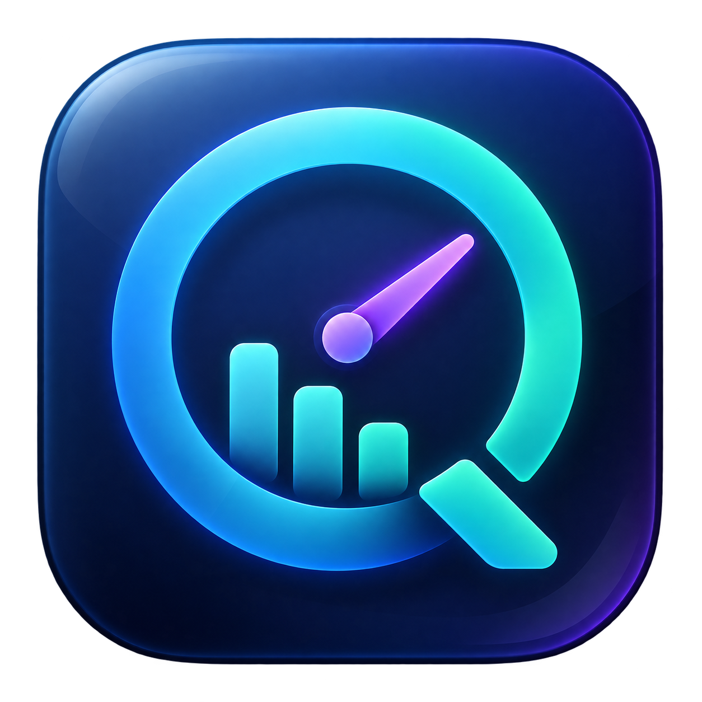

<p align="center"></p>
<h1 align="center">AI 桌面卡片</h1>
<p align="center">在 macOS 桌面查看 AI 账号额度与中转站费用。</p>

## 下载与安装

在本仓库 [Releases](https://github.com/dfklkc/ai-quota-dashboard/releases/latest) 下载 `AIQuotaDashboard-1.0.3-macOS-universal.pkg`，或下载 DMG 后把应用拖入 Applications。

- macOS 14 或更高版本；支持 Apple Silicon 与 Intel。
- 内置独立 Python 运行时，使用者无需安装 Python、Xcode 或命令行工具。
- 本版本使用 ad-hoc 本地签名；尚无 Apple Developer ID 签名或公证。下载后 macOS 可能要求用户在系统设置中确认来源。
- `SHA256SUMS.txt` 可用于校验安装包。

## 能查看什么

| 来源 | 数据范围 | 条件 |
| --- | --- | --- |
| App | 当前本机登录账号的 **Codex 使用额度** | 读取当前用户的 Codex 登录信息 |
| Chrome | 当前 ChatGPT 会话对应的 **Codex 使用额度** | 已登录页面、现有自动化与 Apple 事件 JavaScript 权限 |
| Antigravity | 服务实际提供的 Gemini / Claude 额度窗口 | 本机应用及额度服务运行中 |
| CC Switch 中转站 | 当前提供商的站点余额/Key 用量，以及可取得的请求、Token、模型统计 | 读取 CC Switch 所选客户端的当前配置；站点提供兼容用量接口 |

GPT 卡片不是 ChatGPT 聊天次数计数器。不存在的窗口显示“未提供”。当前会话读取失败时，不沿用上一个账号的额度。

中转站的“未设限 Key”可以提供累计用量，但不能据此推算账户钱包余额；没有返回的余额明确显示未提供。钱包余额和 Key 额度分别显示，不从小时额度或其他账号推算。

## CC Switch 中转站用量

在设置中选择“CC Switch 当前提供商”，再选择 Claude Code、Claude Desktop、Codex 或 Gemini。应用只读 CC Switch 的数据库和当前设备选择，不修改配置、不复制 Key；切换提供商或更换 Key 后自动跟随，旧来源的退避和分析缓存不会混入新来源。只查询选中的客户端，不轮询全部提供商。

- 支持 NewAPI 的 Key 用量接口；CC Switch 已保存同站点访问令牌和用户 ID 时，可查询账户钱包。金额只按站点声明的换算比例转换，否则保留原始额度单位。
- 支持 Sub2API `/v1/usage` 返回的余额/Key 用量字段。未识别的站点、自定义脚本或特殊路径会明确提示不支持，不执行 CC Switch 的 JavaScript。协议参考 [CC Switch 用量查询文档](https://github.com/farion1231/cc-switch/blob/main/docs/user-manual/en/2-providers/2.5-usage-query.md)。
- NewAPI 日志按当前 Key 统计：本地时区的今日、近7个自然日（含今天）、请求数、输入+输出 Token、费用，以及返回日志中的主要模型。最多处理接口返回的最近1000条；这是返回记录内的统计，不能作为完整账单。
- 站点日志不可用或被限流时，只在确有记录的情况下显示 CC Switch 对应客户端和提供商的本机估算；没有记录时显示未提供，不把缺失数据当作零用量。
- 每分钟只读检查 CC Switch 是否切换；同一来源的站点用量和统计约每5分钟自动查询，HTTP 429 后至少等待5分钟，手动刷新可立即查询。统计缓存只保存聚合值，不保存原始日志、请求内容、IP 或 Key。

旧的手动 LinksAPI 与 Claude 本地配置方式保留在兼容选项中。升级保留已有设置；可在设置中切换至 CC Switch。

## 日常使用

- 自动每分钟检查来源；普通连接失败按 60 / 120 / 240 / 300 秒退避重试。CC Switch 同一中转站约5分钟查询一次，减少站点请求与限流。
- 手动刷新可立即重试；各来源完成后独立显示。
- 查询进度只在刷新且卡片可见时更新，隐藏或被完全遮挡时暂停界面定时器；全部来源停用时不启动查询进程。
- Chrome 跟随模式取得首个优先会话后停止读取，减少无用的后台标签请求。
- 可切换紧凑模式、置顶、低额度阈值。系统通知默认关闭。
- 未置顶时卡片贴在桌面，其他应用可以覆盖它；只有置顶时才悬浮。设置窗口也跟随置顶状态。
- 关闭卡片仅隐藏窗口，通过菜单栏重新显示或退出。再次打开应用也会恢复窗口。
- 首次运行生成默认配置。升级保留已有用户配置、登录凭证与显示偏好。

## 数据与隐私

发布包不包含任何真实账号、浏览器会话、API Key、密码或额度缓存。

用户数据保存在 `~/.swiftbar/`，与应用包分离。手动保存的中转站查询凭证保存在专用 `tokens/linksapi.json`，权限为 `0600`；CC Switch 与兼容的跟随 Claude 模式直接读取本机现有配置，不复制 Key。卸载应用不会删除这些数据。

接口均使用 HTTPS 读取查询数据；不会为了显示余额发送模型生成请求。CC Switch 凭证仅发往当前提供商配置中确认的同源 HTTPS 公网站点；兼容的手动 LinksAPI 模式仅请求固定主机。拒绝自动重定向及跨站发送凭证。

## 从源码构建

开发机需要 macOS、Swift / Clang / Xcode Command Line Tools、Python 3 和 GitHub CLI。构建时从 `astral-sh/python-build-standalone` 的固定版本下载运行时，并核对仓库记录的 SHA-256。

```sh
python3 -m unittest discover -s tests -v
python3 scripts/test_window_presentation.py
python3 scripts/test_display_activity.py
python3 scripts/check_public_content.py --history
python3 scripts/build.py
python3 scripts/verify_release.py
```

产物位于 `dist/`：PKG、DMG、发布清单及 SHA-256 文件。构建脚本只复制明确列出的源码和默认配置，不从开发者的用户目录取数据。

可用干净数据目录进行离线自检：

```sh
AI_QUOTA_DATA_DIR="$(mktemp -d)" ".build.noindex/AI 桌面卡片.app/Contents/MacOS/AIDesktopCard" --self-check
```

`--self-check` 验证默认配置及内置运行时，不读取登录账号或发起额度请求。Chrome 延迟响应的人工回归检查在 `tests/check_chrome_bridge_live.py`，需要运行中的 Chrome 与 ChatGPT 页面。

## 项目结构

- `src/`：SwiftUI 主程序、Chrome 原生桥接和 Python 查询模块。
- `assets/`：图标 PNG、ICNS 与生成提示词。
- `config/`：不含凭证的默认配置。
- `runtime/manifest.json`：运行时来源、固定版本及校验摘要。
- `scripts/`：可复现构建与发行包验证。
- `tests/`：额度、账号切换、隐私和接口异常回归检查。

第三方运行时许可说明见 `docs/THIRD_PARTY.txt`，完整许可随运行时保留在应用包中。

## 公开维护

代码、默认配置、构建脚本、验证检查和发行安装包在本仓库公开。后续优化在本地及 CI 验证后提交并推送；涉及应用行为的改动同步更新 Release。项目不会把真实账号配置、登录凭证或本机额度缓存加入 Git。公开内容检查同时覆盖当前文件与历史版本。
